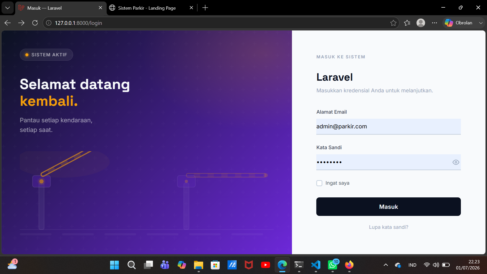
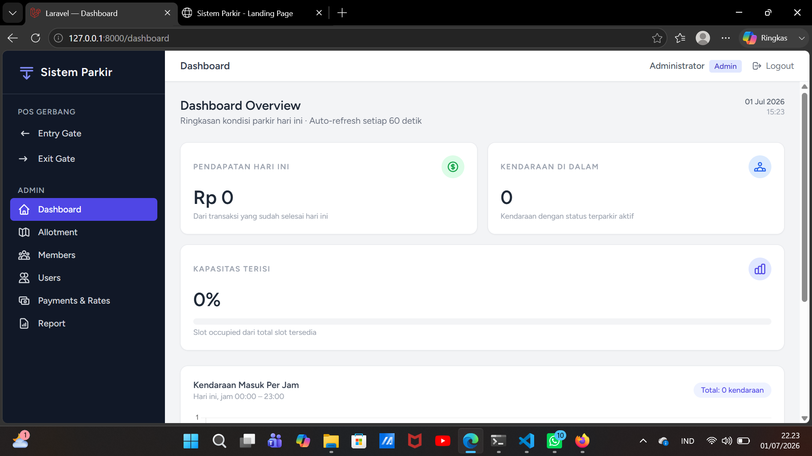
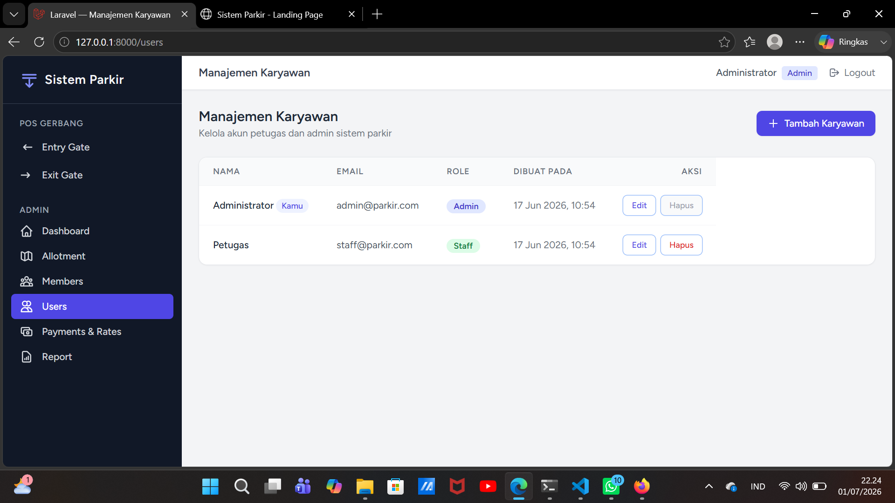
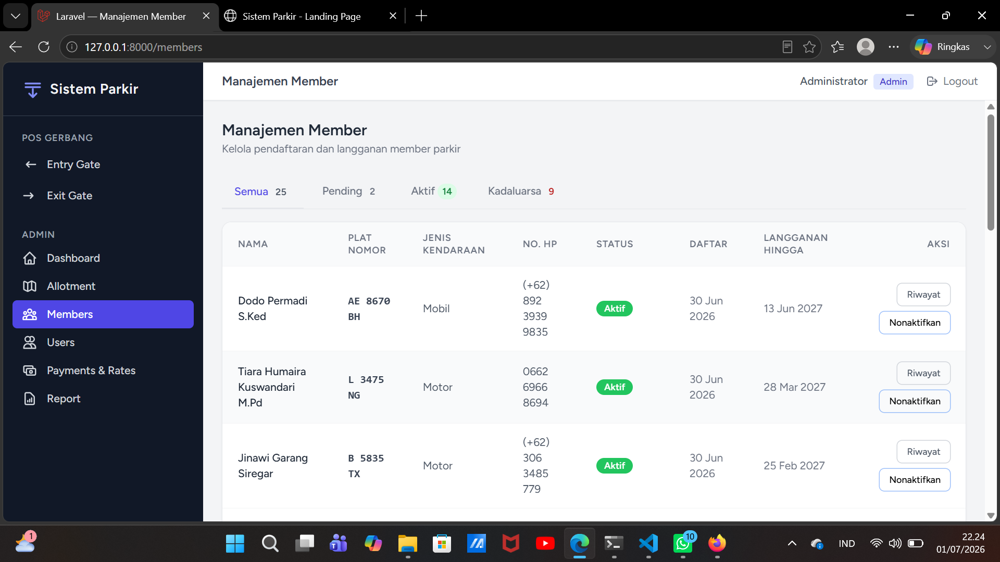
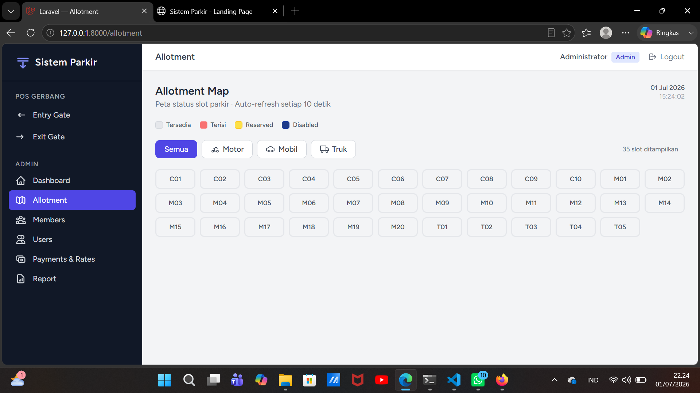
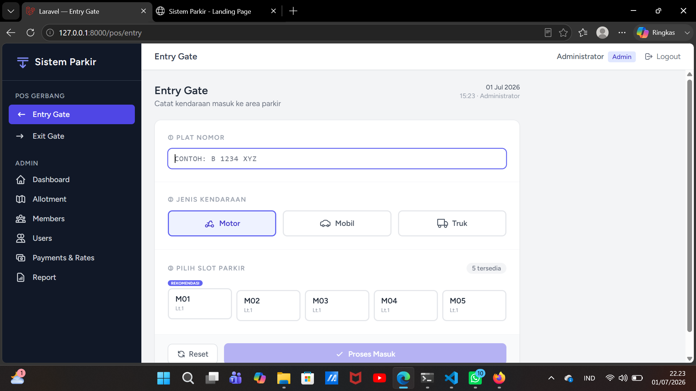
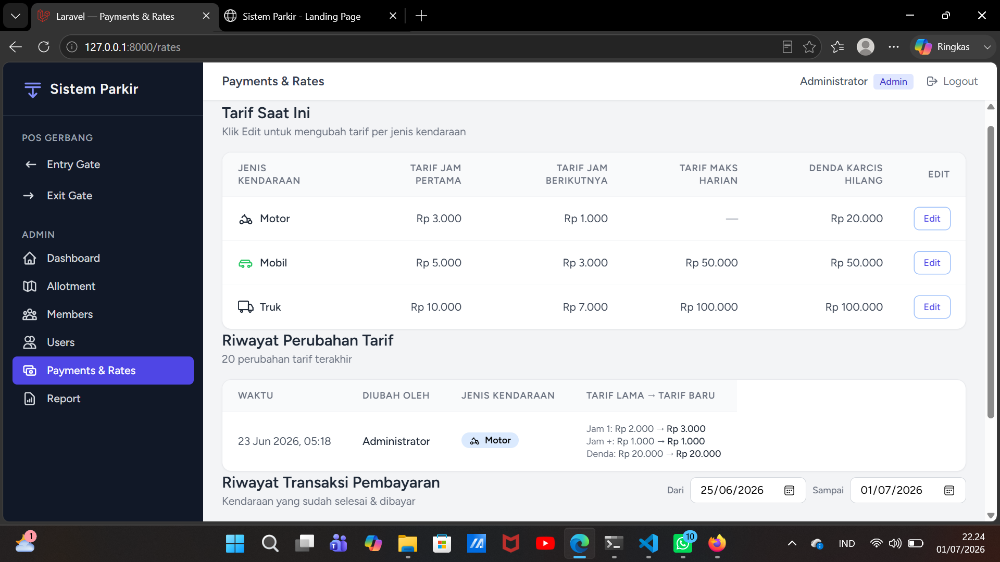
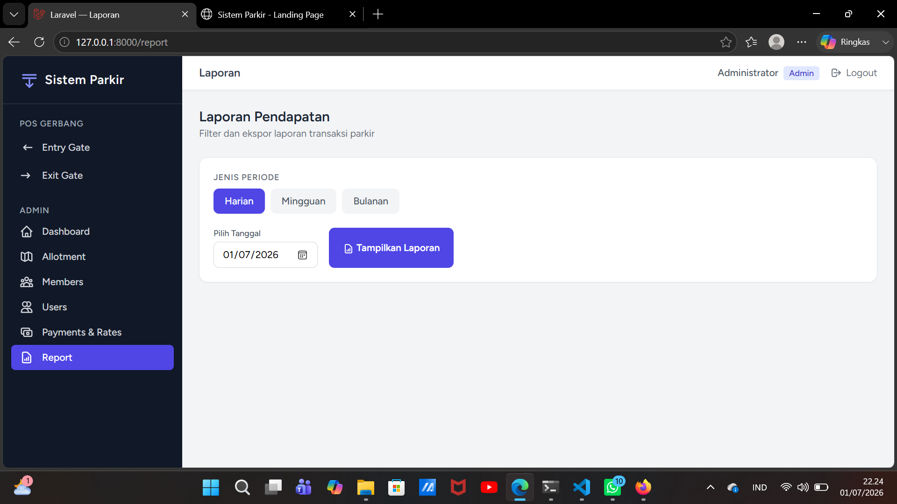

# 🚗 Sistem Manajemen Parkir

## 📌 Tentang Project

Sistem Manajemen Parkir merupakan aplikasi berbasis web yang dikembangkan untuk membantu proses pengelolaan parkir secara lebih terstruktur dan efisien.

Aplikasi ini dibuat sebagai proyek mandiri untuk menerapkan pengetahuan dan keterampilan dalam pengembangan aplikasi web menggunakan framework Laravel.

## 🛠️ Teknologi yang Digunakan

- **PHP** – Bahasa pemrograman backend.
- **Laravel** – Framework untuk pengembangan aplikasi web.
- **MySQL** – Database untuk menyimpan data sistem.
- **HTML** – Membuat struktur halaman web.
- **CSS** – Mengatur tampilan halaman web.
- **JavaScript** – Mendukung interaksi pada halaman web.
- **Blade Template** – Template engine Laravel.
- **Vite** – Asset bundler untuk mengelola file frontend.

## ✨ Fitur Utama

1. **Login dan Autentikasi Pengguna**  
   Mengelola akses pengguna ke dalam sistem.

2. **Manajemen Data Kendaraan**  
   Mengelola informasi kendaraan yang menggunakan area parkir.

3. **Perhitungan Tarif Parkir Otomatis**  
   Menghitung biaya parkir berdasarkan durasi kendaraan berada di area parkir.

4. **Manajemen Member Parkir**  
   Mengelola data anggota atau pengguna parkir.

5. **Monitoring Slot Parkir**  
   Memantau ketersediaan slot parkir.

6. **Pembayaran Parkir**  
   Mengelola proses pembayaran biaya parkir.

7. **Laporan Parkir**  
   Menampilkan laporan aktivitas parkir.

8. **Dashboard**  
   Menampilkan informasi utama sistem.

## 📸 Screenshots

### 1. Login

### 2. Dashboard

### 3. Data Pengguna

### 4. Manajemen Member

### 5. Monitoring Slot Parkir

### 6. Entry Kendaraan

### 7. Exit Kendaraan

### 8. Pembayaran

### 9. Laporan

## 🎯 Tujuan Project

Mengembangkan aplikasi pengelolaan parkir berbasis web sebagai penerapan pengetahuan dan keterampilan dalam pengembangan aplikasi, khususnya menggunakan framework Laravel, serta membantu proses pengelolaan data kendaraan, pembayaran, dan pemantauan area parkir.

---

**Developed by Atiya Puti Betriyona**
